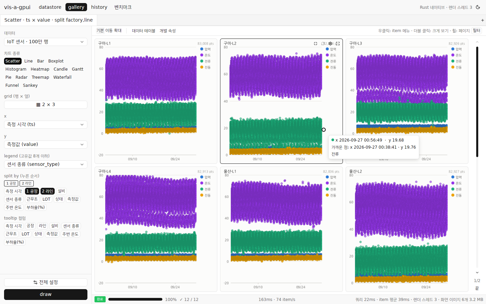
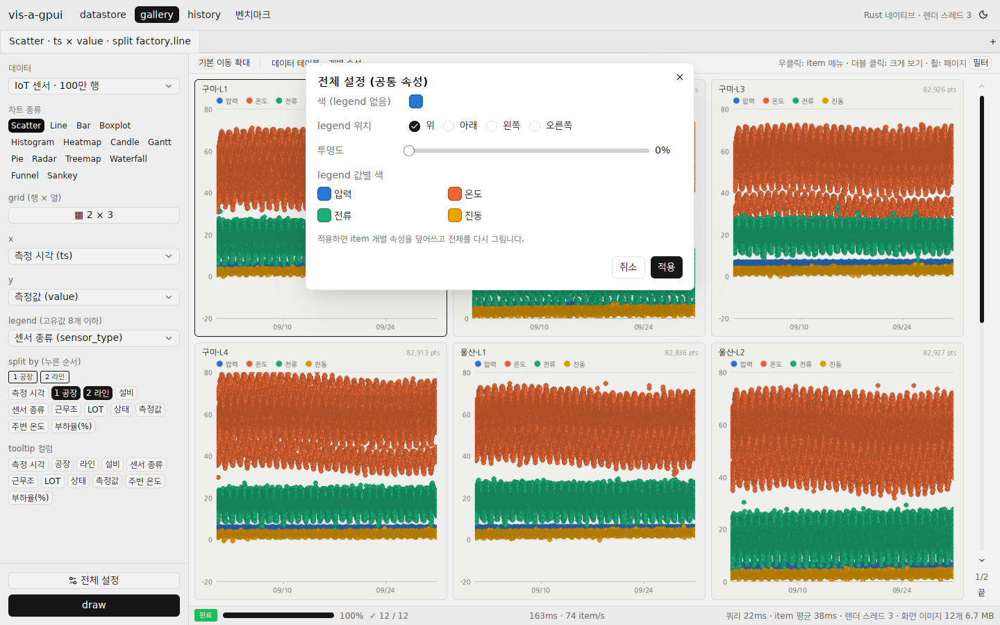
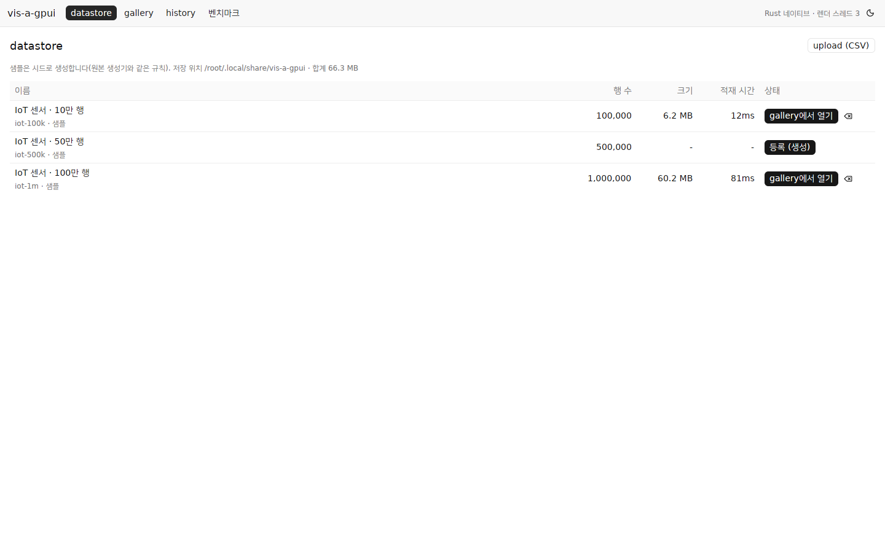
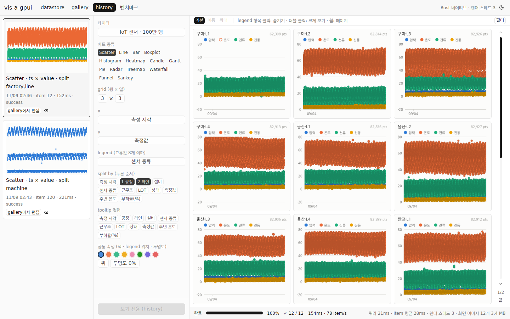
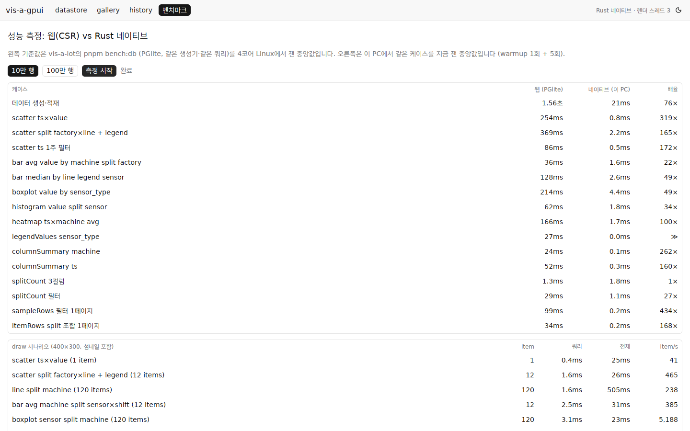
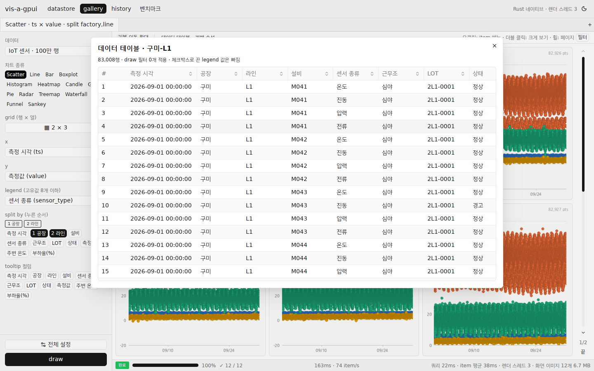
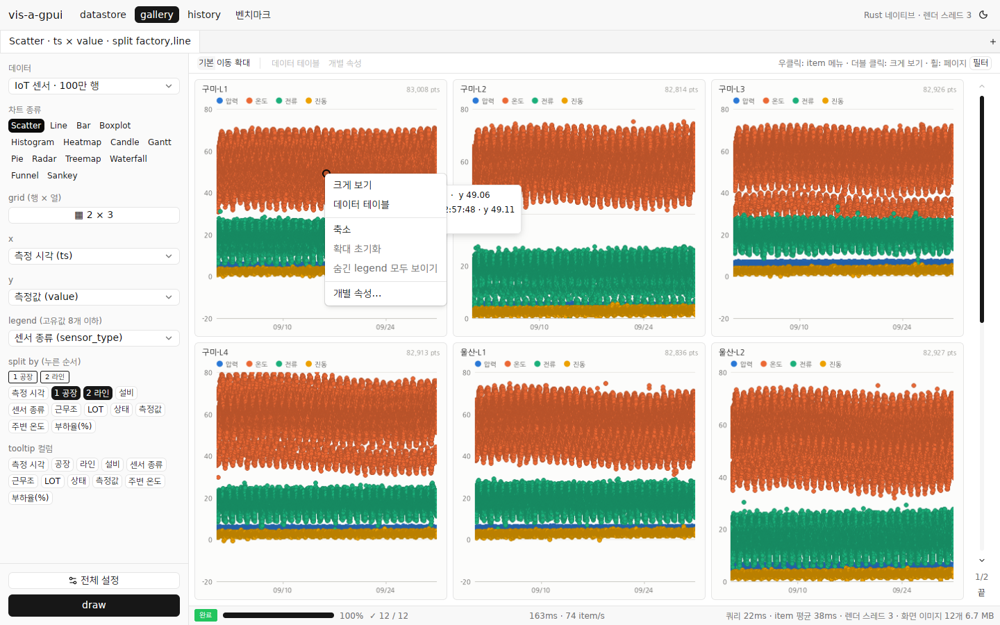
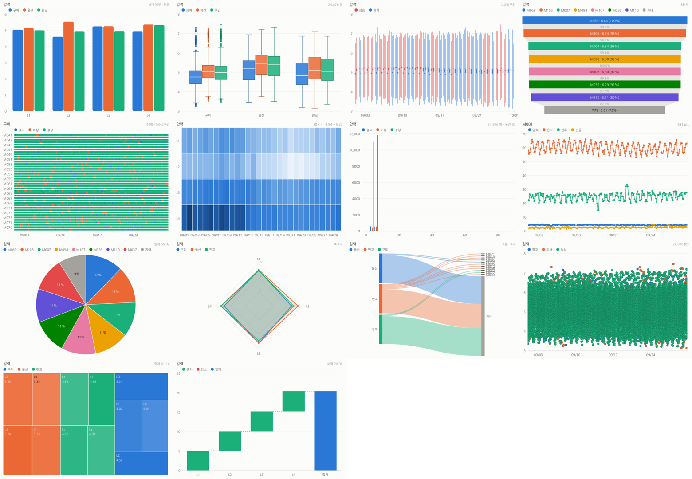

# vis-a-gpui

[vis-a-lot](https://github.com/Ring-wdr/vis-a-lot)(브라우저에서 "서버"를 돌리는 CSR 시각화 프로토타입)의 시각화 화면을 **Rust 네이티브 데스크톱 앱**으로 옮긴 것입니다. UI는 [GPUI Kit](https://gpui-kit.com/)(`gpui-kit` 0.9, GPUI + gpui-component)로 만들었고, Windows가 1차 대상입니다(macOS·Linux에서도 빌드됩니다).

목적은 **"지금 CSR로 도는 프로젝트를 Rust 네이티브로 옮기면 클라이언트 쪽 성능이 얼마나 바뀌는가"** 를 같은 데이터·같은 케이스로 재 보는 것입니다. 결과는 [`docs/performance.md`](docs/performance.md)에 있습니다.

> 도움말(`/help`)과 피드(`/feed`)는 옮기지 않았습니다.



## 결과 요약

같은 4코어 PC, 같은 IoT 100만 행에서 (자세한 표·방법·주의점은 [`docs/performance.md`](docs/performance.md)):

| 항목 | 웹 (vis-a-lot) | 네이티브 (vis-a-gpui) | 배율 |
|---|---:|---:|---:|
| 데이터 등록 (생성 + 적재, 브라우저) | 24.0초 | 0.14초 | 약 170× |
| scatter 쿼리 (ts×value) | 2,247ms | 13ms | 168× |
| boxplot 쿼리 (value by sensor_type) | 2,134ms | 17ms | 124× |
| draw: scatter split 12 item | 3,600ms | 148ms | 24× |
| draw: boxplot split 120 item | 4,454ms | 44ms | 102× |
| draw: histogram split 4,941 item | 15,802ms | 1,085ms | 15× |
| draw: line split 120 item | 2,919ms | 371ms | 8× |

이득은 대부분 **데이터 쪽**(WASM Postgres 단일 스레드 → 열 배열 + 멀티코어 집계, Worker 간 직렬화 제거)에서 나고, 렌더 자체는 브라우저 Canvas 2D(Skia)도 빨라 3~20배 수준입니다.

## 구조

원본은 화면(React) → MSW → gateway → 서비스(Hono) → DB Worker(PGlite, WASM Postgres) / Render Worker(OffscreenCanvas → PNG) 순으로 브라우저 안에서 REST를 흉내 냈습니다. 네이티브 판은 같은 단계를 한 프로세스의 스레드로 돕니다.

```
[GPUI 화면 (gpui-kit)] ──JobRequest──▶ [job 스레드]
   · 왼쪽 설정 패널 · item grid · 필터 · job 바         │ 1. 쿼리: 필터 → split 조합 → 차트별 집계 (rayon 병렬, 열 배열)
   · 33ms마다 끝난 item을 가져와 GPU 이미지로 올림        │ 2. 렌더: 렌더 스레드 N개(코어 수 − 1)가 item을 순서대로 가져가
   · 툴팁·확대·legend 숨김은 metadata로 바로              │    tiny-skia로 래스터화 (PNG 인코딩 없이 BGRA 그대로 넘김)
                                                        ▼
                                          [Store: 열 단위 데이터셋, 앱 데이터 폴더에 바이너리로 저장]
```

| 원본 (vis-a-lot) | 네이티브 (vis-a-gpui) |
|---|---|
| PGlite(WASM Postgres) 테이블, SQL 집계 | 열 배열(`Vec<f64>`, 범주는 사전 + `u32` 코드), Rust 집계 (`crates/vis-core/src/query`) |
| 생성기 → CSV 조각 → `COPY` | 같은 생성기(같은 시드·같은 난수 mulberry32)로 열 배열을 바로 채움 (`generator.rs`) |
| Render Worker × N, OffscreenCanvas 2D → PNG → Cache API | 렌더 스레드 × N, tiny-skia → BGRA → GPUI `RenderImage` (`render/`) |
| 화면 ↔ 서비스: REST + long polling | 같은 프로세스: 원자 변수 진행 상태 + 결과 칸 (`job.rs`) |
| 툴팁 추가 컬럼은 서버 호출 | 행 번호로 열 배열에서 바로 읽음 |
| IndexedDB(데이터셋·history) | `%LOCALAPPDATA%\vis-a-gpui` (데이터셋 바이너리, history JSON + 섬네일 PNG) |

### 크레이트

- `crates/vis-core` — UI 없는 엔진: 데이터셋·생성기·CSV 가져오기·필터·split·집계·렌더러 14종·job·history·벤치마크. `vis-bench` CLI 포함.
- `crates/vis-app` — GPUI 앱 (`vis-a-gpui.exe`).

## 옮긴 기능

| 영역 | 내용 |
|---|---|
| 데이터 | IoT 샘플 10만 / 50만 / 100만 행 등록(생성), CSV 업로드(구분 기호·헤더·null·타입 추론), 데이터 목록·삭제, 앱 데이터 폴더에 유지 |
| 차트 | scatter, line(M4 줄이기), bar(통계 함수 6종), boxplot(사분위수·1.5 IQR·이상치), histogram, heatmap(시간 구간), candle(OHLC), gantt(gaps-and-islands), pie(상위 8 + 기타), radar, treemap, waterfall, funnel, sankey — 원본 14종 전부 |
| split by | 누른 순서대로 조합, 최대 30,000 item, grid 1×1 ~ 10×10, 페이지 막대·휠로 페이지 이동 |
| 렌더 job | 쿼리 → 렌더 스레드 N개, item별로 끝나는 대로 표시, 하단 바(단계·진행률·완료/진행/실패·경과·item/s·남은 시간·쿼리 시간·렌더 스레드 수), cancel |
| 툴팁 | metadata로 바로: 점 차트는 커서 좌표 + 가장 가까운 점(픽셀 칸마다 한 점), 나머지는 막대·상자·조각 단위 통계. tooltip 컬럼 추가 |
| 확대·이동 | 확대 모드 드래그, 이동 모드 드래그, 축소, 확대 초기화 (item마다) |
| legend | 범주 컬럼(고유값 8개 이하)으로 색 나누기, PNG의 legend 항목을 눌러 item별로 값 숨기기 |
| 필터 | 컬럼별 아코디언: 숫자·시계열 범위 + 반전 + null, 범주 검색 + 가상 목록 체크. draw할 때 적용 |
| 공통 속성 · 개별 속성 | 전체 설정: 색, legend 값별 색, legend 위치, 투명도 (item 개별 속성을 덮어씀). item ⚙: 그 item의 색·legend 색·legend 위치, 공통 따르기 |
| 데이터 테이블 | 고른 item의 원본 행(split 조합 + draw 필터 + 숨긴 legend 제외), 열 정렬 |
| 우클릭 메뉴 | 크게 보기 · 데이터 테이블 · 축소 · 확대 초기화 · 숨긴 legend 모두 보이기 · 개별 속성 |
| 화면 크기 | 크기 변경이 멈추고 300ms 뒤 보이는 item만 다시 그림(그동안 이전 이미지를 늘려 보임) |
| 크게 보기 | 더블 클릭 / ⤢ 버튼, `<< < > >>`로 item 이동 |
| history | draw마다 1건(섬네일), item 상태(확대·숨긴 legend) 덧붙임, 다시 보기 전용 탭, gallery에서 편집 |
| 탭 | gallery 탭 여러 개, 탭마다 작업 상태 |
| 벤치마크 화면 | 원본 `pnpm bench:db`와 같은 케이스를 이 PC에서 재고 웹 기준값과 배율 표시 |

### 원본 UI → gpui-kit 컴포넌트

원본(Base UI · 네이티브 popover · 직접 만든 조각)에서 쓰던 화면 요소를 gpui-kit 기본 컴포넌트로 옮겼습니다.

| 원본 화면 요소 | gpui-kit |
|---|---|
| 데이터 · x · y · z · legend · 통계 함수 Select (Base UI Select) | `Select` (+ `SearchableVec`, 컬럼 목록은 검색 가능) |
| grid 크기 10 × 10 칸 고르기 (popover) | `Popover` 안의 칸 격자 |
| 전체 설정 팝업 · item ⚙ 개별 속성 팝업 (overlay-kit Dialog) | `Dialog` + `ColorPicker` (색 · legend 값별 색) + `RadioGroup` (legend 위치) + `Slider` (투명도) |
| item 우클릭 메뉴 (Base UI ContextMenu) | `ContextMenu` (`ContextMenuExt`) + `PopupMenuItem` |
| 필터 패널 컬럼별 아코디언 · 범위 슬라이더 (Base UI Slider) | `Accordion` (여러 개 열기) + 범위 `Slider` + `Checkbox` + `Input` (검색) |
| 삭제 확인 (AlertDialog) | `AlertDialog` (위험 동작 버튼) |
| datastore 데이터 목록 표 | `Table` |
| 데이터 테이블 (가상 스크롤 · 열 머리 정렬) | `DataTable` + `TableDelegate` |
| 모드 바 (기본 · 이동 · 확대) | `ToggleGroup` / `Toggle` |
| 하단 job 바 | `StatusBar` + `Progress` + `Tag` (단계) |
| 고른 split 순서 표시 | `Tag` |
| 빈 화면 안내 (EmptyState) · 받는 중 자리 표시 (Skeleton) | `Empty` · `Skeleton` |
| gallery 탭 · 알림 · 툴팁 · 버튼 | `TabBar`/`Tab` · `Notification` · `Tooltip` · `Button` |

직접 그린 채로 둔 것: 차트 PNG 위의 툴팁·가까운 점 표시·확대 드래그 영역(차트 metadata 좌표에 맞춰 그려야 함), 오른쪽 페이지 막대(원본도 직접 그린 Windows식 페이지 스크롤바), 필터의 범주 값 목록(수천 개라 GPUI `uniform_list`로 가상화).



범위 밖(원본에는 있음): 로그인·JWT(데스크톱 단일 사용자라 뺌), 공유 링크, 도형(사각형·선·텍스트) 그리기, 영역 선택·즐겨찾기·새 범례·점 삭제, 하위 차트(stack·donut·ECDF …), 차트 속성 세부 설정(축·글꼴·analytics 구역 …), 전체 데이터 표(샘플)·CSV/엑셀 다운로드, 다국어.

## 실행

Windows (권장): GitHub Actions `build` 워크플로의 아티팩트 `vis-a-gpui-windows-x64`에서 `vis-a-gpui.exe`를 받거나 직접 빌드합니다.

```powershell
# Rust stable + Windows SDK (Visual Studio Build Tools의 "Desktop development with C++")
cargo build --release
target\release\vis-a-gpui.exe
```

처음 실행하면 시작 화면에서 **데이터 관리 → 등록**으로 샘플을 만든 뒤 gallery에서 그립니다.

헤드리스 벤치마크 (원본 `pnpm bench:db`와 같은 케이스 + draw 시나리오):

```bash
cargo run --release -p vis-core --bin vis-bench -- --rows 1000000 --iterations 5 [--png] [--out result.json]
cargo run --release -p vis-core --bin vis-bench -- --rows 100000 --samples out/   # 차트 14종 PNG 한 장씩
```

웹 쪽 draw 벤치마크 (vis-a-lot 빌드를 Chromium에서 끝까지 잼):

```bash
(cd ../vis-a-lot && pnpm install && pnpm build && npx serve out -l 4173)
node scripts/web-draw-bench.mjs http://localhost:4173 iot-1m web-draw-1m.json
```

Linux에서 빌드하려면 `libxkbcommon-dev libxkbcommon-x11-dev libwayland-dev libvulkan-dev libx11-xcb-dev libfontconfig-dev`와 한글 글꼴(예: `fonts-nanum`)이 필요합니다.

### Windows 크로스 빌드에 대해

GPUI의 Windows 백엔드(DirectX 11)는 release 빌드에서 HLSL 셰이더를 Windows SDK의 `fxc.exe`로 미리 컴파일합니다. 그래서 Linux에서 `cargo xwin build --release`로는 exe를 만들 수 없고, Windows 러너(CI)나 Windows PC에서 빌드합니다. Linux에서는 `cargo xwin check --target x86_64-pc-windows-msvc`로 Windows 대상 컴파일 검사만 합니다.

## 화면

| datastore | history | 벤치마크 |
|---|---|---|
|  |  |  |

| 데이터 테이블 | 우클릭 메뉴 |
|---|---|
|  |  |

차트 14종 (`vis-bench --samples`):



## 글꼴

차트 글자는 시스템 글꼴을 찾아 씁니다: Windows는 맑은 고딕, macOS는 Apple SD Gothic Neo, Linux는 Noto Sans CJK KR / 나눔고딕.
