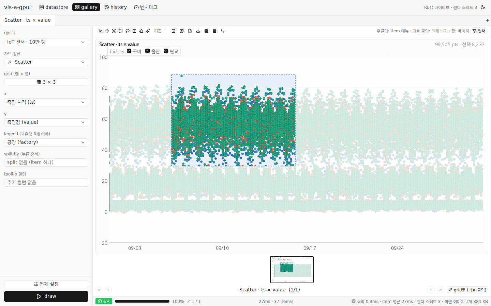
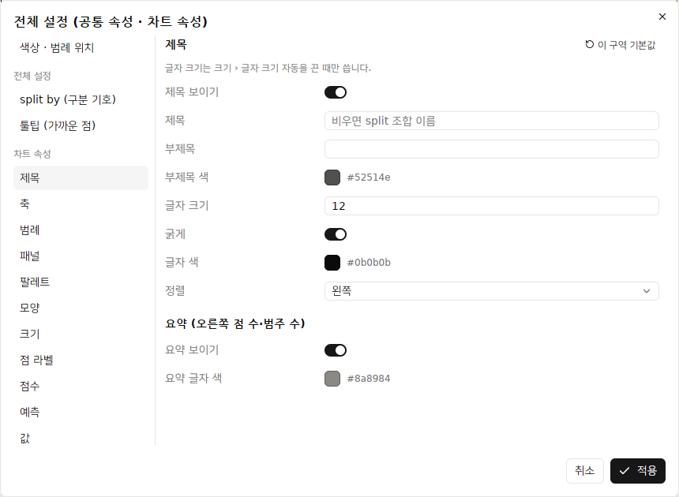
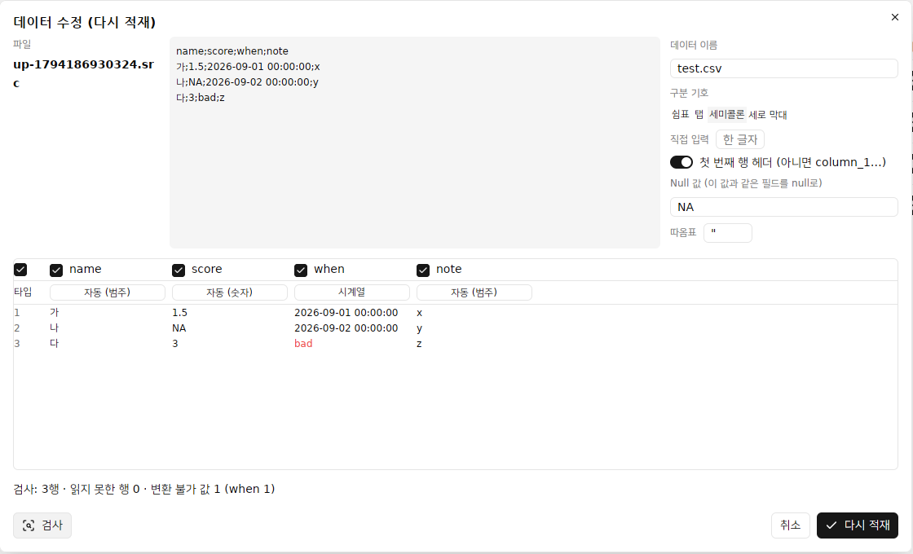
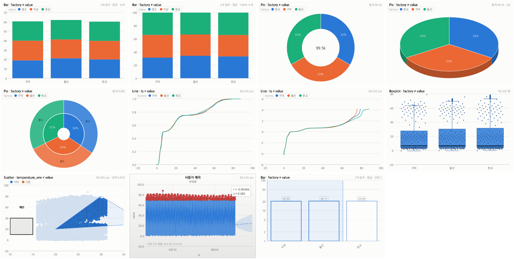

# vis-a-gpui

[vis-a-lot](https://github.com/Ring-wdr/vis-a-lot)(브라우저에서 "서버"를 돌리는 CSR 시각화 프로토타입)의 시각화 화면을 **Rust 네이티브 데스크톱 앱**으로 옮긴 것입니다. UI는 [GPUI Kit](https://gpui-kit.com/)(`gpui-kit` 0.9, GPUI + gpui-component)로 만들었고, Windows가 1차 대상입니다(macOS·Linux에서도 빌드됩니다).

목적은 **"지금 CSR로 도는 프로젝트를 Rust 네이티브로 옮기면 클라이언트 쪽 성능이 얼마나 바뀌는가"** 를 같은 데이터·같은 케이스로 재 보는 것입니다. 결과는 [`docs/performance.md`](docs/performance.md)에 있습니다.

> 도움말(`/help`)과 피드(`/feed`)는 옮기지 않았습니다.


## 결과 요약

같은 4코어 PC, 같은 IoT 100만 행에서 (자세한 표·방법·주의점은 [`docs/performance.md`](docs/performance.md)):

| 항목 | 웹 (vis-a-lot) | 네이티브 (vis-a-gpui) | 배율 |
|---|---:|---:|---:|
| 데이터 등록 (생성 + 적재, 브라우저) | 24.0초 | 0.14초 | 약 170× |
| scatter 쿼리 (ts×value) | 2,247ms | 13ms | 168× |
| boxplot 쿼리 (value by sensor_type) | 2,134ms | 17ms | 124× |
| draw: scatter split 12 item | 3,600ms | 148ms | 24× |
| draw: boxplot split 120 item | 4,454ms | 44ms | 102× |
| draw: histogram split 4,941 item | 15,802ms | 1,085ms | 15× |
| draw: line split 120 item | 2,919ms | 371ms | 8× |

이득은 대부분 **데이터 쪽**(WASM Postgres 단일 스레드 → 열 배열 + 멀티코어 집계, Worker 간 직렬화 제거)에서 나고, 렌더 자체는 브라우저 Canvas 2D(Skia)도 빨라 3~20배 수준입니다.

## 구조

원본은 화면(React) → MSW → gateway → 서비스(Hono) → DB Worker(PGlite, WASM Postgres) / Render Worker(OffscreenCanvas → PNG) 순으로 브라우저 안에서 REST를 흉내 냈습니다. 네이티브 판은 같은 단계를 한 프로세스의 스레드로 돕니다.

```
[GPUI 화면 (gpui-kit)] ──JobRequest──▶ [job 스레드]
   · 왼쪽 설정 패널 · item grid · 필터 · job 바         │ 1. 쿼리: 필터 → split 조합 → 차트별 집계 (rayon 병렬, 열 배열)
   · 33ms마다 끝난 item을 가져와 GPU 이미지로 올림        │ 2. 렌더: 렌더 스레드 N개(코어 수 − 1)가 item을 순서대로 가져가
   · 툴팁·확대·legend 숨김은 metadata로 바로              │    tiny-skia로 래스터화 (PNG 인코딩 없이 BGRA 그대로 넘김)
                                                        ▼
                                          [Store: 열 단위 데이터셋, 앱 데이터 폴더에 바이너리로 저장]
```

| 원본 (vis-a-lot) | 네이티브 (vis-a-gpui) |
|---|---|
| PGlite(WASM Postgres) 테이블, SQL 집계 | 열 배열(`Vec<f64>`, 범주는 사전 + `u32` 코드), Rust 집계 (`crates/vis-core/src/query`) |
| 생성기 → CSV 조각 → `COPY` | 같은 생성기(같은 시드·같은 난수 mulberry32)로 열 배열을 바로 채움 (`generator.rs`) |
| Render Worker × N, OffscreenCanvas 2D → PNG → Cache API | 렌더 스레드 × N, tiny-skia → BGRA → GPUI `RenderImage` (`render/`) |
| 화면 ↔ 서비스: REST + long polling | 같은 프로세스: 원자 변수 진행 상태 + 결과 칸 (`job.rs`) |
| 툴팁 추가 컬럼은 서버 호출 | 행 번호로 열 배열에서 바로 읽음 |
| IndexedDB(데이터셋·history) | `%LOCALAPPDATA%\vis-a-gpui` (데이터셋 바이너리, history JSON + 섬네일 PNG) |

### 크레이트

- `crates/vis-core` — UI 없는 엔진: 데이터셋·생성기·CSV(zip) 가져오기·필터·split·집계·렌더러 14종(+ 하위 차트)·차트 속성(`options.rs`)·영역·도형(`region.rs`)·분석(식·이상치·예측·점수·분포, `analytics.rs`)·job·history·벤치마크. `vis-bench` CLI 포함.
- `crates/vis-app` — GPUI 앱 (`vis-a-gpui.exe`).

## 옮긴 기능

| 영역 | 내용 |
|---|---|
| 데이터 | IoT 샘플 10만 / 50만 / 100만 행 등록(생성). 업로드 팝업: CSV 또는 CSV zip(이름순으로 합침, 스키마가 다르면 전체 거절), 전처리 옵션(구분 기호 4종 + 직접 입력, 첫 행 헤더, Null 값, 따옴표, 인코딩 자동/UTF-8/EUC-KR, 데이터 오류 무시), 원본 앞부분, 미리보기 표(컬럼 포함 체크 · 타입 자동/범주/숫자/시계열, 바꿀 수 없는 값은 빨갛게), `검사`(전체 행 수 · 컬럼별 변환 불가 수), 거절 사유 표시. datastore: 이름 검색, 등록 시간, `수정`(보관한 원본을 같은 팝업에서 옵션·타입·포함 컬럼을 바꿔 다시 적재, 등록 시간 유지), 삭제, 새로고침 |
| 차트 | scatter, line(M4 줄이기), bar(통계 함수 6종), boxplot(사분위수·1.5 IQR·이상치), histogram, heatmap(시간 구간), candle(OHLC), gantt(gaps-and-islands), pie(상위 8 + 기타), radar, treemap, waterfall, funnel, sankey — 원본 14종 전부 |
| 하위 차트 | line: 기본 · ECDF · 정규 CDF · 정규 확률(분포 좌표) / bar: 나란히 · 쌓기 · 100% 쌓기 / boxplot: 기본 · 점 겹치기(원값 표본 jitter) / pie: 기본 · 도넛(가운데 합계) · 3D(눕힌 원 + 옆면) · 선버스트(legend 컬럼을 바깥 고리로). 왼쪽 패널 `하위 차트` Select |
| 모드 바 | 기본 · 이동 · 확대 · 사각형 선택 · 자유형 선택 · 사각형 삭제 · 자유형 삭제 · 페인트. 그린 차트가 지원하지 않는 모드는 막고 이유를 툴팁으로(확대·이동은 축 차트, 삭제는 scatter·line(분포 제외)), 못 쓰게 되면 기본 모드로. 모드별 커서 |
| 영역 선택 | 사각형·자유형(데이터 좌표, 확대·이동해도 같은 데이터). 점 차트는 선택 밖을 패널 배경으로 덮고(even-odd), 나머지는 대표 좌표(막대 끝 · 상자 중앙값 · 조각 중심)가 밖인 도형을 흐리게. 점선 테두리, 제목 줄에 `선택 N`, 클릭하면 해제. 끄는 동안 미리보기 |
| 즐겨찾기 · 새 범례 | 우클릭: `즐겨찾기에 추가…` · `새 범례…`(영역 안의 점을 새 legend 항목으로, legend 컬럼이 없으면 나머지는 '기타') · `선택 해제` · `즐겨찾기 선택 ▸` · `즐겨찾기 삭제 ▸` · `새 범례 삭제 ▸`. item 상태라 history로 되살아남 |
| 점 삭제 | 사각형·자유형 삭제(scatter·line). 지운 영역을 item 상태로 쌓아 점 수·툴팁·선택 수·데이터 표에서도 뺌. item 툴바 `지운 점 되돌리기`(마지막), 우클릭 `지운 점 모두 되돌리기` |
| 도형 (페인트) | item 좌측 상단 페인트 도구: 사각형 · 선 · 자유곡선 · 텍스트 메모(데이터 좌표), 그리는 동안 미리보기, undo(마지막 도형) · 모두 지우기. PNG 안에 함께 그림 |
| 차트 속성 | 원본 `ChartOptions` 14구역을 전체 설정·item ⚙ 팝업 왼쪽 메뉴로: 제목(문구·부제목·크기·굵게·색·정렬·요약), 축 X/Y(보이기·제목·최솟값·최댓값·로그 축·선·그리드·눈금 개수/길이·글자 각도/크기/색·소수 자리·날짜 형식), 범례(보이기·테두리·순서 뒤집기·글자), 패널(배경·그라데이션·테두리·여백), 팔레트(그라데이션 단계 색·기타 색), 모양(점 모양 5종·채우기/테두리·투명도·테두리 굵기/색·선택 밖 진하기·모서리 둥글기·중앙값 색), 크기(점 자동/고정/최소/최대·글자 자동·선 굵기), 점 라벨(위치·각도·앞뒤 글자·소수·상자), 점수(r · F · z · Cpk, 상한·하한), 예측(이동 평균 · 단순/이중 지수 평활 · Holt-Winters, 신뢰 구간 띠, 설명), 값(빈 칸 값 · 이상치 빼기 IQR/σ), 강조(x/y 조건 · 색 · 모양 · 크기 · 나머지 한 색), 툴팁(제목·글자·배경·투명도·모서리·테두리·앞뒤 글자·소수), 식(x·y에 수식, eval 없는 파서). 차트 종류별 지원 표(`OPTION_SUPPORT`)대로 메뉴를 보이고, 기본 → 테마 → 차트 종류 → 공통 → 개별 순으로 합침. 구역마다 `이 구역 기본값` |
| split by | 누른 순서대로 조합, 최대 30,000 item, grid 1×1 ~ 10×10, 페이지 막대·휠로 페이지 이동 |
| 렌더 job | 쿼리 → 렌더 스레드 N개, item별로 끝나는 대로 표시, 하단 바(단계·진행률·완료/진행/실패·경과·item/s·남은 시간·쿼리 시간·렌더 스레드 수), cancel |
| 툴팁 | metadata로 바로: 점 차트는 커서 좌표 + 가장 가까운 점(픽셀 칸마다 한 점), 나머지는 막대·상자·조각 단위 통계. tooltip 컬럼은 draw 없이 왼쪽 패널 선택을 바로 따른다(그린 데이터셋에 없는 컬럼과 그린 x·y는 뺌, vis-a-lot develop과 같다) |
| 확대·이동 | 확대 모드 드래그, 이동 모드 드래그, 축소, 확대 초기화 (item마다) |
| legend | 범주 컬럼(고유값 8개 이하)으로 색 나누기, PNG의 legend 글자를 눌러 item별로 값 숨기기, ●를 눌러 그 값의 색 바꾸기(새 범례 항목도) |
| 필터 | 컬럼별 아코디언: 숫자·시계열 범위 + 반전 + null, 범주 검색 + 가상 목록 체크. draw할 때 적용 |
| 공통 속성 · 개별 속성 | 전체 설정: 색, legend 값별 색, legend 위치, 투명도, split 구분 기호, 툴팁 가까운 점 표시, 차트 속성 (item 개별 속성을 덮어씀). item ⚙: 그 item의 색·legend 색·legend 위치·차트 속성, 공통 따르기 |
| 차트 도구 | 체크박스 표시(legend 항목에 체크박스), 차트 다운로드(고른 item PNG), 모든 차트 엑셀로 다운로드(300개까지, 시트에 이름 + 그림), 데이터 다운로드(고른 item 행 CSV, UTF-8 BOM, 선택이면 `_선택`), 데이터 테이블, 전체 데이터 테이블(30,000행 표본) |
| 데이터 테이블 | 고른 item의 원본 행(split 조합 + draw 필터 − 숨긴 legend − 지운 점, 선택 영역이 있으면 그 안: scatter·line은 점, bar·boxplot·histogram·waterfall은 막대 끝·중앙값), 열 정렬 |
| 우클릭 메뉴 | 크게 보기 · 데이터 테이블 · 차트/데이터 다운로드 · 선택 영역 메뉴(위) · 축소 · 확대 초기화 · 숨긴 legend 모두 보이기 · 지운 점 모두 되돌리기 · 도형 모두 지우기 · 개별 속성 |
| 화면 크기 | 크기 변경이 멈추고 300ms 뒤 보이는 item만 다시 그림(그동안 이전 이미지를 늘려 보임) |
| 크게 보기 | 더블 클릭 / ⤢ 버튼, 아래 섬네일 줄(128 × 80, 누르면 그 item), `<< < > >>`로 item 이동. 크게 보기에서도 모드·페인트 도구가 그대로 |
| history | draw마다 1건(섬네일), item 상태(확대·숨긴 legend·개별 속성·도형·선택·즐겨찾기·새 범례·지운 영역) 덧붙임, 다시 보기 전용 탭(기본 모드만), gallery에서 편집 |
| 탭 | gallery 탭 여러 개, 탭마다 작업 상태 |
| 벤치마크 화면 | 원본 `pnpm bench:db`와 같은 케이스를 이 PC에서 재고 웹 기준값과 배율 표시 |

### 원본 UI → gpui-kit 컴포넌트

원본(Base UI · 네이티브 popover · 직접 만든 조각)에서 쓰던 화면 요소를 gpui-kit 기본 컴포넌트로 옮겼습니다.

| 원본 화면 요소 | gpui-kit |
|---|---|
| 데이터 · x · y · z · legend · 통계 함수 Select (Base UI Select) | `Select` (+ `SearchableVec`, 컬럼 목록은 검색 가능) |
| grid 크기 10 × 10 칸 고르기 (popover) | `Popover` 안의 칸 격자 |
| 전체 설정 팝업 · item ⚙ 개별 속성 팝업 (overlay-kit Dialog, 왼쪽 메뉴) | `Dialog` + `ColorPicker` (색 · legend 값별 색) + `ToggleGroup` (legend 위치) + `Slider` (투명도) |
| 차트 속성 구역 폼 (OptionSectionForm, 필드 표 option-fields.ts) | 같은 필드 표를 옮긴 `option_fields.rs` → `Switch` · `Input` · `ColorPicker`(+ `Checkbox` 비움) · `Select` · `ToggleGroup`(점수 목록) |
| 업로드 팝업 · 미리보기 표 | `Dialog` + `Input` · `Switch` · `ToggleGroup` · `Checkbox`(컬럼 포함) · `Button`(타입) |
| 텍스트 메모 · 즐겨찾기 이름 · 새 범례 이름 | `Dialog` + `Input` (Enter = 확인) |
| legend ● 색 바꾸기 | `Dialog` + `ColorPicker` |
| 페인트 도구 (PaintToolbar) | `ToggleGroup` + `Button` (Square · Slash · PenLine · Type · Undo2 · Eraser) |
| item 우클릭 메뉴 (Base UI ContextMenu) | `ContextMenu` (`ContextMenuExt`) + `PopupMenuItem` |
| 필터 패널 컬럼별 아코디언 · 범위 슬라이더 (Base UI Slider) | `Accordion` (여러 개 열기) + 범위 `Slider` + `Checkbox` + `Input` (검색) |
| 삭제 확인 (AlertDialog) | `AlertDialog` (위험 동작 버튼) |
| datastore 데이터 목록 표 | `Table` |
| 데이터 테이블 (가상 스크롤 · 열 머리 정렬) | `DataTable` + `TableDelegate` |
| 모드 바 8종 · 차트 도구 (ModeBar · ChartActionBar) | `ToggleGroup` / `Toggle` (아이콘 + 막힌 이유 툴팁) · `Button` |
| 우클릭 하위 메뉴 (즐겨찾기 선택 ▸ …) | `PopupMenu::submenu` |
| 하단 job 바 | `StatusBar` + `Progress` + `Tag` (단계) |
| 고른 split 순서 표시 | `Tag` |
| 빈 화면 안내 (EmptyState) · 받는 중 자리 표시 (Skeleton) | `Empty` · `Skeleton` |
| gallery 탭 · 알림 · 툴팁 · 버튼 | `TabBar`/`Tab` · `Notification` · `Tooltip` · `Button` |

| split by · tooltip 순서 다중 선택 (OrderedSelect) | `Combobox` 다중 선택 (누른 순서 유지, 고른 순서를 `Tag`로) |
| 오른쪽 페이지 스크롤바 | `Pagination` (+ 휠로 한 페이지씩) |
| 필터 범주 값 목록 (가상 목록 + 드래그 선택) | `VirtualList` (`v_virtual_list`) + `Checkbox`, 누른 채 훑으면 한꺼번에 바뀜 |
| 차트 종류 Select (ChartIcon) | `Select` + 원본 `ChartIcon` 14종을 옮긴 SVG |
| 아이콘 (lucide-react) | gpui-kit의 Lucide 아이콘 (`gpui_kit::assets::IconName`) |

### 아이콘

gpui-kit에는 Lucide 1.43 아이콘 1,818개가 모두 들어 있습니다. 기본 등록(`gpui_kit::assets::Assets`)은 컴포넌트가 쓰는 101개만 바이너리에 넣으므로, 원본에서 쓰던 나머지는 `icon_assets!`로 골라 `AppAssets`에 더합니다(`crates/vis-app/src/assets.rs`). 차트 종류 아이콘은 원본 `entities/chart/ui/ChartIcon.tsx`의 그림을 `crates/vis-app/assets/icons/chart-*.svg`로 옮겨 같은 자산 소스에 넣었습니다. Lucide 1.43에서 이름이 바뀐 아이콘은 대응 이름을 씁니다(history → `RotateCcwClock`, filter → `Funnel`, trash-2 → `Trash`).

직접 그린 채로 둔 것: 차트 이미지 위의 툴팁·가까운 점 표시·드래그 미리보기(확대·선택·삭제 사각형, 자유형·자유곡선 길은 GPUI `PathBuilder`)·legend 체크박스. 커서를 따라 움직이며 차트 metadata 좌표(데이터 값 ↔ 픽셀)에 맞춰 그려야 해서 gpui-kit의 `Tooltip`(요소에 붙어 지연 뒤 뜨는 고정 위치)으로는 대신할 수 없습니다. 색은 gpui-kit 테마의 popover 색을 씁니다.


범위 밖(원본에는 있음): 도움말, 피드(요청대로 이식하지 않음), 로그인·JWT와 공유 링크·공유 페이지(데스크톱 단일 사용자, 서버 없음), 다국어(한국어만).

차트 속성의 글자: 글꼴 하나(시스템 한글 글꼴)라 `굵게`는 0.5px 옆으로 한 번 더 찍어 흉내 내고, 축 글자 각도는 글자를 따로 그린 뒤 돌려 붙입니다.

## 실행

Windows (권장): GitHub Actions `build` 워크플로의 아티팩트 `vis-a-gpui-windows-x64`에서 `vis-a-gpui.exe`를 받거나 직접 빌드합니다.

```powershell
# Rust stable + Windows SDK (Visual Studio Build Tools의 "Desktop development with C++")
cargo build --release
target\release\vis-a-gpui.exe
```

처음 실행하면 시작 화면에서 **데이터 관리 → 등록**으로 샘플을 만든 뒤 gallery에서 그립니다.

헤드리스 벤치마크 (원본 `pnpm bench:db`와 같은 케이스 + draw 시나리오):

```bash
cargo run --release -p vis-core --bin vis-bench -- --rows 1000000 --iterations 5 [--png] [--out result.json]
cargo run --release -p vis-core --bin vis-bench -- --rows 100000 --samples out/   # 차트 14종 PNG 한 장씩
```

웹 쪽 draw 벤치마크 (vis-a-lot 빌드를 Chromium에서 끝까지 잼):

```bash
(cd ../vis-a-lot && pnpm install && pnpm build && npx serve out -l 4173)
node scripts/web-draw-bench.mjs http://localhost:4173 iot-1m web-draw-1m.json
```

Linux에서 빌드하려면 `libxkbcommon-dev libxkbcommon-x11-dev libwayland-dev libvulkan-dev libx11-xcb-dev libfontconfig-dev`와 한글 글꼴(예: `fonts-nanum`)이 필요합니다.

### Windows 크로스 빌드에 대해

GPUI의 Windows 백엔드(DirectX 11)는 release 빌드에서 HLSL 셰이더를 Windows SDK의 `fxc.exe`로 미리 컴파일합니다. 그래서 Linux에서 `cargo xwin build --release`로는 exe를 만들 수 없고, Windows 러너(CI)나 Windows PC에서 빌드합니다. Linux에서는 `cargo xwin check --target x86_64-pc-windows-msvc`로 Windows 대상 컴파일 검사만 합니다.

## 화면

| datastore | history | 벤치마크 |
|---|---|---|
|  |  |  |

| 데이터 테이블 | 우클릭 메뉴 |
|---|---|
|  |  |

| 영역 선택 · 체크박스 표시 · 크게 보기 섬네일 줄 | 차트 속성 (전체 설정 › 제목) | 업로드 수정 (타입 · 검사) |
|---|---|---|
|  |  |  |

하위 차트 · 차트 속성 · 선택 · 도형 (`cargo run --release -p vis-core --example variants -- out/`):



차트 14종 (`vis-bench --samples`):


## 글꼴

차트 글자는 시스템 글꼴을 찾아 씁니다: Windows는 맑은 고딕, macOS는 Apple SD Gothic Neo, Linux는 Noto Sans CJK KR / 나눔고딕.
